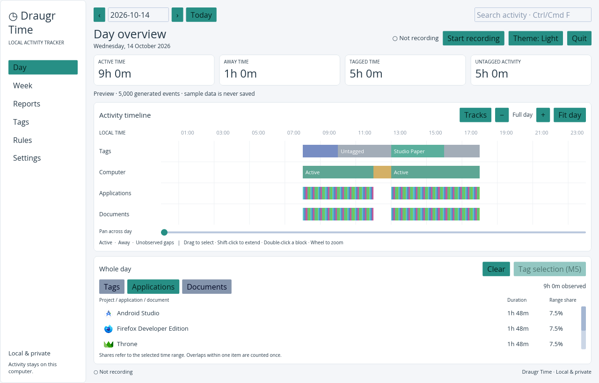
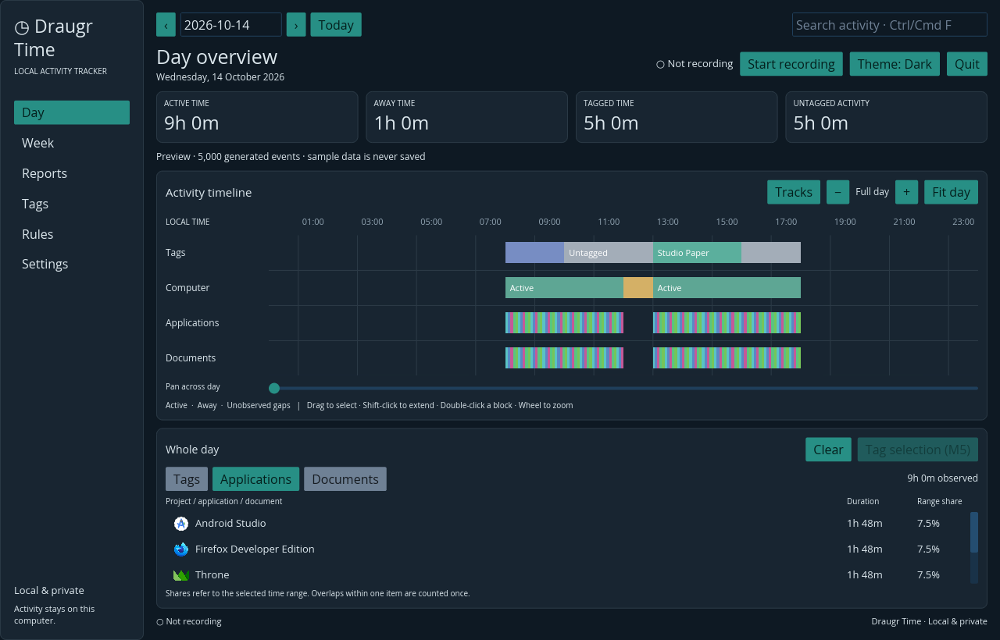

<div align="center">

# Draugr Time

**Local activity tracking with a native Rust desktop app.**

[](https://github.com/hlophlopgaming/DraugrTime/actions/workflows/ci.yml)
[](LICENSE)


**English** · [Русский](README.ru.md) · [Deutsch](README.de.md) · [Français](README.fr.md) · [Español](README.es.md) · [Português](README.pt-BR.md) · [简体中文](README.zh-CN.md) · [日本語](README.ja.md)

</div>

Draugr Time records your active application, window title and active/away time,
then shows them on a daily timeline. It is a free, GPL-3.0 project inspired by
ManicTime's workflow. Your history stays on your computer.

> **Early development:** tracking and the Day view work. Tag editing, rules,
> reports, import/export and browser URL collection are still planned.

## What works

- Native **Iced** UI with light, dark and system themes.
- Active-window and idle tracking on Windows, macOS and Linux X11.
- Wayland backends for GNOME, KDE, Sway and Hyprland. GNOME/KDE need a local
  compositor bridge; see [Wayland setup](docs/wayland.md).
- Day timeline with computer, application, document and tag tracks; zoom, pan,
  range selection, duration summaries, hierarchical tags and away-time tagging.
- Background recording, tray controls, pause/resume and optional startup at login.
- Local SQLite storage and a selectable data folder.

One executable contains the UI, tracking, storage and localhost API. There is
no web frontend or separate service to launch. Normal launches have no demo mode.

## Screenshots

These screenshots show generated sample history, not personal activity.





## Build and run

Install stable Rust. Linux needs GTK 3, Ayatana AppIndicator, librsvg and
libxkbcommon-x11 development packages. Windows needs MSVC; macOS needs Xcode
command-line tools. Installers are not available yet.

```sh
git clone https://github.com/hlophlopgaming/DraugrTime.git
cd DraugrTime
cargo run --release --package draugr-time
```

The executable is `target/release/draugr-time` (`.exe` on Windows). Press
**Start recording** to collect activity. Closing the window keeps recording
in the tray; **Quit** stops the application.

See [development instructions](docs/DEVELOPMENT.md) for checks and diagnostics,
and [desktop usage](docs/desktop.md) for settings and platform notes.

## Data and privacy

- History is stored locally in SQLite. No account, cloud uploads or telemetry.
- Application network traffic stays on localhost; compositor IPC stays local.
- New installations use the OS local-data folder under `DraugrTime`. Existing
  installations can continue using their legacy `DagdaTime` folder.
- Settings → Data folder selects another folder for the next launch; existing
  history remains in its current location.

## Roadmap

- [x] **M0–M3.5:** workspace, storage, native watchers, local API and desktop shell.
- [x] **M4:** Day timeline, range selection and summaries.
- [x] **M5:** tag editing, tag manager and away-time tagging.
- [ ] **M6:** automatic tagging rules.
- [ ] **M7:** Week view, reports, CSV/JSON export and ActivityWatch import.
- [ ] **M9:** Firefox/Chromium extension for browser URLs.
- [ ] **M10:** onboarding, privacy settings, backups and installers.

Details: [PLAN.md](PLAN.md) · [Architecture decisions](docs/decisions.md).

## Contributing

Open an [issue](https://github.com/hlophlopgaming/DraugrTime/issues) to discuss a
change. Help with desktop permissions, Wayland integrations and real OS testing
is welcome. Agent instructions are in [AGENTS.md](AGENTS.md).

## License

[GNU GPLv3](LICENSE). Draugr Time is independent of ManicTime and ActivityWatch.
