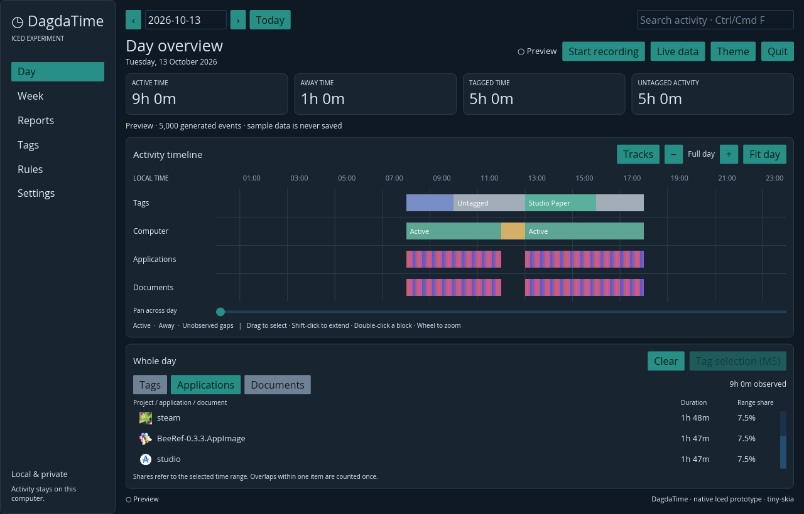

# Iced desktop experiment

This branch keeps the existing Tauri app intact and adds a standalone native
Iced frontend as `dagdatime-iced`. It is an experiment for comparing the same
timeline workflow and memory use before deciding whether to replace the main
frontend.

## Try it

Run `cargo run --release --package dagdatime-app --bin dagdatime-iced` or
download the `DagdaTime-Iced-*` artifact from this branch's GitHub Actions run.
The first screen is a generated preview of 5,000 events; it does not read or
write the activity database. Use the Theme control to switch palettes and try
date navigation, search, track visibility/order, zoom, pan, range selection,
and the summaries. The Day view opens on Applications so each real process has
its system icon beside its total; zooming in also shows icons on wider blocks
in the Applications track. On Linux, preview events use up to five installed
applications discovered from desktop entries, keeping each real executable path
as its process identity so the matching system icon appears. If no app icons can
be resolved, the preview falls back to generated names and monogram placeholders.

To record real activity, quit the running DagdaTime/Tauri app from its tray,
then select **Start recording** in the Iced app. It uses the existing DagdaTime
data directory and database. The two versions cannot record simultaneously
because they share the local API port. **Settings → Choose data folder** saves
the selected directory for the next launch; it does not move existing history.
Quit from the tray to stop recording. Closing only the window keeps the tray
app and recording alive.

Enable **Settings → Start DagdaTime when I log in** to add the current binary to
your user startup. Linux uses XDG Autostart, macOS uses a LaunchAgent, and
Windows uses the current user's startup registry entry. It starts tracking
minimized to the tray. Keep the binary in its current location after enabling
this setting; if you move it, turn the setting off and on again to update the
registered path.

On Linux, the executable uses the host's GTK tray integration and builds both
X11 and Wayland window backends. Install GTK 3 and libxkbcommon-x11 runtime
libraries if your distribution does not already provide them. Other systems
use their native window and tray integration. The application UI is one
executable and does not start a tracker helper.

## Current memory sample

On 2026-10-13, a release build on Linux/KDE Wayland with the 5,000-event
preview used 36.1 MiB PSS while the window was open and 27.2 MiB after closing
it to the tray. The canvas geometry build peaked at 0.59 ms. Compare PSS
(proportional set size), not RSS, because shared libraries are counted in each
process's RSS. The existing Tauri run on this machine measured about 293–304
MiB PSS across its app and WebKit processes while recording. Those runs had
different workloads, so the values indicate scale, not a controlled benchmark.
The Iced sample had no recording database load and the Tauri sample did.

## Checks and platform follow-up

CI builds and launches the actual Iced window on Linux, macOS, and Windows. Its
runtime check records mock window samples to a temporary SQLite database; the
lifecycle check closes the native window, checks that recording continues,
then reopens the window from the tray. CI also enables and disables the real
per-user startup registration on an isolated runner. These checks do not
exercise real focus, accessibility permissions, tray interaction, or system
theme integration on each desktop. Native app icon extraction is implemented
for Linux; Windows and macOS still use the app initials until their native icon
providers are added.

Manually check the release binary on macOS with Accessibility permission
granted, on Windows with several foreground applications, and on Linux under
both X11 and Wayland. Confirm the correct application icons, tray open/quit,
folder selection, timeline drag/zoom/pan, and that recording continues while
the window is closed. This container's local native run covers KDE Plasma on
Wayland only.
